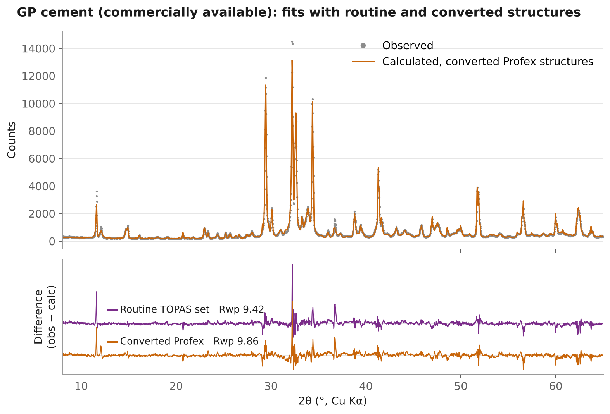

# Profex .str to TOPAS .str Converter

A Python script that batch-converts Profex/BGMN `.str` crystal structure files into TOPAS `.str` files, for example the ~1,100 structures supplied with a Profex install.

[](https://doi.org/10.5281/zenodo.19134548)

Code written by prompting Microsoft Copilot. Code review and bug fixes (v2 and v3 updates, October 2026) aided by Claude (Anthropic). All crystallographic requirements and conversion rules were defined, tested and validated by the author.

> **Always check the output.** Compare each converted structure with the original Profex `.str` before using it in a refinement. The original Profex line is kept as a comment beside every converted line to make this easy. There may be edge cases I have missed.

---

## What's new in v3

* **TOPAS-readable `space_group` lines.** Every setting is written in a form TOPAS accepts (number, `N:2`, short orthorhombic symbol, full monoclinic symbol, `r` for rhombohedral axes, `s` symbols), checked against the symmetry operators TOPAS generates, for all 753 `SPACEGRP.DAT` settings. Settings that no TOPAS symbol reproduces get the new status `CHECK_SPACE_GROUP`. See [What the converter does](#what-the-converter-does).
* **Bug fix: rhombohedral cells.** When a Profex file gave the rhombohedral angle as `GAMMA` or `BETA` instead of `ALPHA`, v2 dropped it and TOPAS used 90°. Affected library files: `Hematite_1.str` and `Ilmenite_1.str` (MarsMineralCompendium). Re-convert these if you used v2 output.
* **Cell values without `PARAM=` are written fixed** (`!`), as BGMN treats them, with a comment saying how to refine them. This matches the existing rule for occupancies.
* **Shorter, cleaner output header:** one line naming the script version, then the Profex symmetry and formula lines as comments.
* **Traceability:** the script version is written into every output file and into a new `script_version` column of the CSV report.
* **Documentation:** validation in TOPAS for each type of space-group notation, a worked GP cement example, and a note that preferred orientation and layer-disorder models are not converted.

---

## Quick start

1. Install [Python 3](https://www.python.org/downloads/) (tick **"Add python.exe to PATH"** during install). No extra packages are needed.
2. Download `ProfexStr_to_TOPAS_v3.py` from the [latest release](../../releases/latest).
3. Open **Command Prompt** in the folder containing the script and run:

```
py ProfexStr_to_TOPAS_v3.py --in "C:\Program Files\Profex5\Structures\Minerals" --out "%USERPROFILE%\Documents\TOPAS_str\Minerals"
```

The converted `.str` files and a CSV report appear in the output folder.

---

## Requirements

* **Windows** (the paths and commands below are for Windows).
* **Python 3** (a current version from python.org). Only the Python standard library is used, so nothing else needs installing.
* **Profex installed** (tested with Profex 5). The script reads `SPACEGRP.DAT` from the Profex install.

## Step-by-step

### 1. Install Python

Download Python 3 from [python.org](https://www.python.org/downloads/) and run the installer. On the first screen, tick **"Add python.exe to PATH"**.

To check it worked, open Command Prompt and type `py --version`. You should see something like `Python 3.12.4`.

If you see **"Python was not found"**, Python is not on your PATH: re-run the installer, choose *Modify*, and tick *Add Python to environment variables*. If `py` does not work but `python` does, use `python` in all the commands below.

### 2. Download the script

Go to the [latest release](../../releases/latest) and download either `ProfexStr_to_TOPAS_v3.py` or *Source code (zip)* (then unzip it). Save the `.py` file in a folder of your choice, e.g. `Documents\ProfexConverter`.

Do not copy and paste the code from the GitHub page. Use the download.

### 3. Open Command Prompt in that folder

In File Explorer, open the folder containing the `.py` file, click the address bar, type `cmd` and press Enter.

> **Use Command Prompt, not PowerShell.** On Windows 11, right-clicking a folder and choosing *Open in Terminal* opens PowerShell, where the commands below do not work. If the window title or prompt says `PS C:\...`, type `cmd` and press Enter to switch to Command Prompt.

### 4. Run the converter

**One folder:**

```
py ProfexStr_to_TOPAS_v3.py --in "C:\Program Files\Profex5\Structures\Minerals" --out "%USERPROFILE%\Documents\TOPAS_str\Minerals"
```

**Every Profex structure folder in one go:**

```
for /d %F in ("C:\Program Files\Profex5\Structures\*") do py ProfexStr_to_TOPAS_v3.py --in "%F" --out "%USERPROFILE%\Documents\TOPAS_str\%~nxF"
```

(In a `.bat` file, write `%%F` and `%%~nxF` instead of `%F` and `%~nxF`.)

If you are in PowerShell, use this version of the loop instead:

```
Get-ChildItem "C:\Program Files\Profex5\Structures" -Directory | ForEach-Object { py ProfexStr_to_TOPAS_v3.py --in $_.FullName --out "$env:USERPROFILE\Documents\TOPAS_str\$($_.Name)" }
```

Notes:

* `%USERPROFILE%\Documents` is your own Documents folder. You can use any folder you can write to, but not one inside `Program Files`.
* Use a new, empty output folder for each run. Existing files are never overwritten; a second copy is saved as `name_1.str`.
* `SPACEGRP.DAT` is looked for at `C:\Program Files\Profex5\BGMNwin\SPACEGRP.DAT`. If Profex is installed elsewhere, add `--dat "path\to\SPACEGRP.DAT"`.

When it finishes, the window shows a short summary, e.g.:

```
Wrote canary report: ...\_canary_report_20261021_212643.csv
Canary summary: total=104, files_failed=0, files_with_skips=0, ...
```

### 5. Check the results

Open the CSV report in the output folder (see [CSV report](#csv-report)). Look at any row whose status is not `OK`, then check the converted files you plan to use against the originals.

### 6. Use a converted structure in TOPAS

Each output file holds one `str` block. Copy it into your `.inp` file below the `xdd` (or `hkl_Is`) it belongs to, or include it with `#include "Quartz.str"`. Edit refinement flags and starting values as needed.

---

## Example

Profex input (`QUARTZ.STR`, supplied with Profex):

```
PHASE=Quartz //
SpacegroupNo=154 //
PARAM=A=0.4913_0.49^0.4935 PARAM=C=0.5404_0.538^0.545 GAMMA=120 //
RP=3 PARAM=B1=0.0_0.0^0.01  //
GEWICHT=SPHAR0 GOAL:quartz=GEWICHT*ifthenelse(ifdef(d),exp(my*d*3/4),1) GOAL=GrainSize(1,0,1)
E=SI+4  Wyckoff=a x=0.47 TDS=0.0056
E=O-2  Wyckoff=c x=0.415 y=0.268 z=0.786 TDS=0.0096
```

TOPAS output (`QUARTZ.STR`, complete):

```
/* Converted from Profex QUARTZ.STR by ProfexStr_to_TOPAS 3.0 (ProfexStr_to_TOPAS_v3.py), Henry Spratt */

str
  /* NOTE: Profex did not specify Setting; using SPACEGRP.DAT Setting=1 default. */

  phase_name "Quartz"
  space_group "154"
  /* Profex: SpacegroupNo=154 */

  a a_Quartz 4.913000 min=4.900000; max=4.935000;
  c c_Quartz 5.404000 min=5.380000; max=5.450000;
  /* Profex GAMMA=120 is fixed or linked by Trigonal symmetry, so it is not refined (see constraints below) */

  /* Unit cell constraints from SPACEGRP.DAT lattice system */
  b = a_Quartz;
  al 90
  be 90
  ga 120

  /* Phase scale, MVW and crystallite size. Suggested CS_L Limits for FP */
  scale scale_Quartz 0.001
  MVW(ZM_Quartz 0, V_Quartz 0, wp_Quartz 0)
  CS_L(csl_Quartz, 200 min 32 max 5000)

  /* Atom sites */
  /* fractional coords output as n/d only when inserted from SPACEGRP.DAT or profex supplied high precision decimals */
  site Si1 x = 0.47; y = 0; z = 2/3; occ Si 1 beq 0.5600 /* E=SI+4  Wyckoff=a x=0.47 TDS=0.0056 */
  site O1 x = 0.415; y = 0.268; z = 0.786; occ O 1 beq 0.9600 /* E=O-2  Wyckoff=c x=0.415 y=0.268 z=0.786 TDS=0.0096 */
```

Note how Si on Wyckoff *a* only had x given in Profex: y = 0 and z = 2/3 were filled in from `SPACEGRP.DAT` as exact fractions.

---

## Design rules

* **The source must prove itself.** The Profex `.str` is assumed to possibly be wrong. Every site is checked against `SPACEGRP.DAT` from the Profex install, which is assumed to be correct.
* **Invent nothing.** Free coordinates are never guessed. A site that cannot be resolved is skipped and flagged, never written with made-up values.
* **Preserve everything.** The original Profex line is kept as a comment beside every TOPAS line it produced.
* **Name parameters meaningfully.** Parameter names are derived from the phase name (e.g. `a_Calcite`, `scale_Calcite`, `csl_Calcite`), so no two phases in a refinement collide.
* **Report every outcome.** Each output folder gets a CSV report listing every file with its status and the reason for any problem.

## What the converter does

**Space group and setting**

* Uses the Setting given in the Profex `.str`; otherwise a unique Hermann–Mauguin (HM) match, a rhombohedral-axes check, or Setting 1 with a NOTE.
* If any site fails against that setting, **every** `SPACEGRP.DAT` setting for the same space group number is tested. Only if exactly one setting matches ALL sites (and suits the given cell) is it used, with a WARNING naming both. If it contradicts the Setting/OriginChoice stated in the Profex file, the warning says so. If several settings match, nothing is changed and the file is flagged as ambiguous.

**`space_group` line (new in v3)**

The `space_group` line is written in a form TOPAS reads:

| Case | Written as | Example |
|---|---|---|
| Standard setting (any crystal system) | space group number | `167` (corundum), `14` (P2₁/c) |
| Cubic/tetragonal, origin choice 2 | number`:2` | `227:2` (spinel, origin 2) |
| Orthorhombic, non-standard axes | short symbol, no slashes | `Pbnm`, `Pnam`, `Fd2d` |
| Orthorhombic, origin choice 2 | short symbol`:2` | `Fddd:2` (thenardite), `Pmmn:2` |
| Monoclinic, non-standard setting | full symbol, no underscores | `P121/n1`, `P1121/b`, `I12/a1` |
| Triclinic, centred cell | centred symbol | `C-1`, `C1`, `I-1` |
| Rhombohedral axes | short symbol + `r` | `R-3cr`, `R3mr` |
| Two settings whose origin TOPAS gives only through its alternative symbol | TOPAS `s` symbol | `C2221s`, `Fdd2s` |
| Any other setting with the same operators as the standard | space group number | `61` (Pbca in the cab setting) |

Every rule was checked against the symmetry operators TOPAS generates from each written symbol: for each of the 753 settings in `SPACEGRP.DAT`, those operators were compared with the `SPACEGRP.DAT` equivalent positions. 727 match exactly. The rest:

* **19 settings have an origin that no TOPAS symbol gives.** These are some non-standard settings of space groups 17, 19, 20, 24, 43 and 70 (e.g. `P2_12_12_1` Setting=2). The file gets status `CHECK_SPACE_GROUP` and a warning giving the exact origin shift: TOPAS's symbol is the same space group with its origin moved, so the Profex coordinates must be shifted before use. The converter does not change the coordinates itself. None of the structures supplied with Profex use these settings.
* **F121** (space group 3, Setting=7) has no TOPAS symbol: status `CHECK_SPACE_GROUP`; enter the space group manually.
* **Pmmm** settings: `SPACEGRP.DAT` lists the general position under the 27th Wyckoff letter, so the operators were not compared. All Pmmm settings are the same group, so this does not matter.

Screw axes are written without underscores (`P212121`, not `P2_12_12_1`): in TOPAS an underscore separates parts of a symbol and does not mean a subscript.

**Atom sites**

* Special-position coordinates are checked against all equivalent positions in `SPACEGRP.DAT`, including centring translations. Coordinates fixed by symmetry are filled in as exact fractions (1/3, not 0.3333).
* General positions must have x, y and z given, otherwise the site is skipped.
* Coordinates are output modulo 1.
* Ionic charges in the Profex element (e.g. `SI+4`) are written as the neutral atom (`Si`); the original is kept in the comment.
* Beq = 100 × TDS. If no TDS is given, `beq 1` is inserted (the TOPAS GUI default when a structure without Beq is imported; note that in launch mode TOPAS uses Beq 0 if none is given).

**Unit cell**

* Profex min/max limits are carried over; if none are given, ±1% is applied.
* Cell values given without `PARAM=` (e.g. `BETA=100.2`) are fixed in BGMN, so they are written fixed (`be !be_phase 100.2 min=…; max=…;`) with a comment: remove the `!` to refine.
* Rhombohedral cells given with the angle as `GAMMA` or `BETA` are written with a refinable `al` and `be = ga = al`.
* Cell parameters fixed or linked by symmetry (e.g. b = a, γ = 120°) are written as constraints, not as refinable values. If the Profex file states such a value (e.g. `GAMMA=120` in a trigonal file), it is kept as a comment only.

**Occupancies**

* Mixed sites are expanded into one TOPAS site per element with shared coordinates.
* Refinable occupancies (`PARAM=p=...`) become named `prm` parameters with the Profex limits, or 0–1 if no limits are given. Each site gets its own name, so sites are never linked by accident.
* Occupancy values defined without `PARAM=` (on the atom line or in the header) are fixed in BGMN, so they are written as fixed parameters (`prm !name value min 0 max 1`) with a comment: they can be refined by removing the `!`, but that is probably not the intent of the source `.str`.
* Values defined as formulas in the header (e.g. `pAL=(1-pMG-pFE)`) become linked TOPAS parameters (`prm pAL_phase = (1-pMG_phase-pFE_phase);`).

**Also inserted:** `scale`, `MVW()` and `CS_L(200 min 32 max 5000)` with derived parameter names.

**Not converted: preferred orientation.** Preferred orientation in the Profex file (`GEWICHT=SPHARn`) is not carried over, and no preferred orientation is written. BGMN guarantees its spherical harmonics to be positive definite (Bergmann, Monecke & Kleeberg, 2001). The spherical-harmonics correction in TOPAS follows Järvinen (1993; see the standard macros in `TOPAS.INC`, TOPAS-Academic v9 Technical Reference, section 22) and carries no such guarantee, so a direct translation can give negative intensities. Negative peaks can be avoided in TOPAS, but not with the exact Profex method. The author believes preferred orientation is best modelled case by case, in whatever way the user sees fit.

* Bergmann, J., Monecke, T. & Kleeberg, R. (2001). Alternative algorithm for the correction of preferred orientation in Rietveld analysis. *J. Appl. Cryst.* 34, 16–19.
* Järvinen, M. (1993). Application of symmetrized harmonics expansion to correction of the preferred orientation effect. *J. Appl. Cryst.* 26, 525–531. https://doi.org/10.1107/S0021889893001219

**Not converted: layer-disorder models.** Profex models of turbostratic layer disorder (`nontronite15a.str` and `smectitedi2wfix1.str` in the BGMN folder) give coordinates as formulas and describe the disorder with BGMN-specific peak-shape settings that a line-by-line conversion cannot carry over. The converter skips their layer sites by design. TOPAS layer models for these clays, interstratified (mixed-layer) clays and a tool to build such models are planned as a separate release.

**Traceability (new in v3):** every output file starts with a comment naming the script version that produced it, and the CSV report has a `script_version` column.

## CSV report

Each output folder gets `_canary_report_<date_time>.csv` with one row per input file. ("Canary" because the report is an early warning: it flags any file that needs a closer look.)

| Column | Meaning |
|---|---|
| status | `OK`, `SKIPPED_SITES` (some sites not written), `UNDEFINED_SYMBOLS` (an occupancy symbol could not be resolved), `CHECK_SPACE_GROUP` (no TOPAS symbol reproduces this setting; see the warning in the file) or `ERROR` (file not converted; see `<name>_ERROR.txt`) |
| setting_note | How the space-group setting was settled when sites failed: resolved by site match, ambiguous, or no setting matches |
| skip_reasons | Why sites were skipped, with counts |
| error | The reason a file could not be converted |
| script_version | Version of the script that wrote the report |

Other columns record the space group, setting, origin, HM symbol and lattice used.

## Results on the structures supplied with Profex

1,113 structure files in 11 folders (Profex 5), converted with v3 in one batch run:

* **1,108 OK**, including CoFe2O4, Cu2O and ZnAl2O4, whose origin was found by testing every `SPACEGRP.DAT` setting (all sites fit origin 2; for CoFe2O4 and Cu2O this contradicts the Profex `.str`).
* **5 with skipped sites:**
  * Arsenolite.str: As given on Wyckoff e (x, x, x) as x=0.3529, y=0, z=0. No equivalent position matches.
  * CRYOLITE.STR: Wyckoff a and b are both given as 0, 0, 0, which is impossible for P2₁/c.
  * CSH-0625.str (CaSO4·0.625H2O): one Ca given on Wyckoff b as (0.2858, 0.2858, 1/6), which matches no position for b. Stoichiometry suggests the coordinates, not the Wyckoff letter, are in error.
  * nontronite15a.str and smectitedi2wfix1.str: layer-disorder models with coordinates given as formulas, skipped by design (see [What the converter does](#what-the-converter-does)).
* **0 not converted.**
* **0 `CHECK_SPACE_GROUP`:** none of the supplied structures uses a setting that TOPAS cannot write.

## Validation in TOPAS

The author checked each type of space-group notation the converter writes by refining the converted `.str` files in TOPAS against measured patterns of samples containing each phase. The test patterns are commercially sensitive or client data and are not publicly available.

| Notation written | Example (converted Profex file) | Result in TOPAS |
|---|---|---|
| Rhombohedral axes (`R-3cr`) | Hematite (rhombohedral setting) | Loads and refines |
| Origin choice 2 (`227:2`) | Magnetite | Loads and refines |
| Origin choice 2 (`Fddd:2`) | Thenardite | Loads and refines |
| Non-standard centred setting (`C1`) | Clinochlore-2A | Loads and refines; fit limited by the sample (a high-Fe chlorite) |
| Non-standard centred setting (`C-1`) | Albite | Loads and refines |
| Non-standard orthorhombic setting (`Bmmb`) | Anhydrite | Loads and refines |
| Monoclinic, full symbol (`P121/n1`) | Belite | Loads and refines |
| Monoclinic, full symbol (`I12/a1`) | Gypsum | Loads and refines |
| Monoclinic, unique axis c (`P1121/b`) | Apatite-OH-m | Loads and refines |

Not tested: the two settings written with TOPAS's alternative `s` symbols (`C2221s`, `Fdd2s`), as no test sample contained such a phase.

### Example: a commercially available GP cement

A general-purpose (GP) cement bought at a retail outlet was measured with Cu Kα radiation and refined twice in TOPAS:

1. **Routine set:** the structures and restraints of the author's routine vendor-supplied TOPAS cement template;
2. **Converted set:** structures converted from the Profex `Cement` and `Cement-PST` folders, with the same restraints (except crystallite size, where the converter's `CS_L` was used), the same background and the same preferred-orientation strategy.

Kept the same in both refinements:

* **Alite:** the same M1 and M3 structures in both. The de la Torre M3 structure (as in Profex) replaced the routine set's usual alite M3 PONKCS model (Bruker copyright).
* **Görgeyite:** the routine set's görgeyite structure in both, as Profex does not include one.

All other phases come from each set's own structures. The converted structures were taken as found in the Profex folders, not chosen to match the routine set, so some (for example belite, calcite, bassanite and gypsum) may be different structure determinations. Ferrite certainly differs: the routine set uses two ferrite phases (Bruker), the converted set one (brownmillerite, Colville).



| Phase (wt%, polymorphs summed) | Routine set | Converted set |
|---|---|---|
| Alite | 57.86 | 57.51 |
| Belite | 15.20 | 14.46 |
| Aluminate (C3A) | 1.79 | 2.39 |
| Ferrite | 10.59 | 10.90 |
| Calcite | 6.51 | 5.78 |
| Bassanite | 2.73 | 3.16 |
| Gypsum | 1.47 | 1.45 |
| Arcanite | 0.85 | 1.05 |
| Görgeyite | 1.00 | 0.83 |
| Aphthitalite | 0.58 | 0.55 |
| Periclase | 0.40 | 0.50 |
| Quartz | 0.30 | 0.32 |
| Lime | 0.27 | 0.42 |
| Langbeinite-Ca | 0.23 | 0.48 |
| Portlandite | 0.23 | 0.20 |
| **Rwp** | **9.42** | **9.86** |

Every phase agrees within 0.75 wt%, with a small increase in Rwp. In the converted set, M1 alite was started at a scale of 0.1 to reach a polymorph split comparable to the routine set; the split between alite polymorphs is sensitive to starting values, so compare alite as a total.

Preferred orientation matters here: the Profex alite files supply none (`GEWICHT=SPHAR0`), and this cement's alite needs it. Choose preferred orientation for your own samples (see *What the converter does*).

## Limitations

* Validated on the 1,113 structures supplied with Profex. Other `.str` sources (hand-written, CIF-derived) have not been tested yet.
* Only `SpacegroupNo=` is read; a file giving only a Hermann–Mauguin symbol will fail with ERROR.
* Coordinates or TDS given as formulas are not evaluated, so layer-disorder models are not converted (see above).
* Preferred orientation from the Profex file is not converted (see [What the converter does](#what-the-converter-does)).
* Windows only (tested on Windows 10/11).

## Planned for v4

* `.cif` input
* Reverse conversion, TOPAS `.str` → Profex `.str`

## Problems or suggestions

Please open an [issue](../../issues) on GitHub, attaching the Profex `.str` file and the CSV report row if possible.

## How to cite

Spratt, H. *Profex .str to TOPAS .str Converter*. Zenodo. https://doi.org/10.5281/zenodo.19134548

(This DOI always points to the latest version. Each release also has its own version DOI on the Zenodo page.)

## Licence

See [LICENSE](LICENSE).
